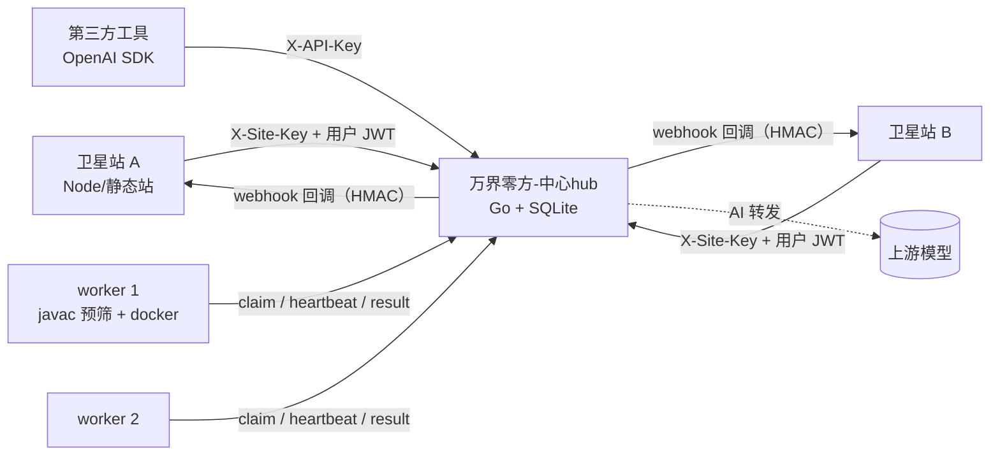

# 万界零方-中心hub

面向 Minecraft 插件 AI 生成的**中心站**（control plane）：统一账号、计费、任务队列、构建调度、配置下发与 AI 中转。
卫星站（前端）与 worker（构建节点）都通过 HTTP 调它。

Go 1.22+ · SQLite（modernc，纯 Go 无 cgo）· 零前端构建链 · 单二进制部署

---

## 它解决什么问题

一个 N 个卫星站 + 1 个中心站 + N 个构建节点的商业形态里，最容易被写乱的是这几件事：

- 用户在哪个站登录都算同一个账号，余额、任务、订阅要打通
- AI 密钥不能下发到卫星站，否则站点 key 泄露 = AI 额度被白嫖
- **AI 生成的 `build.gradle` 是不可信代码**，构建必须隔离
- 每个卫星站要能自己定价，但不能低于平台成本
- 构建失败要退款、要能重试、要能解释原因
- N 个站点、N 个 worker 之后，配置和调度不该靠改代码

这个仓库就是这些问题的答案。

---

## 特性

**账号与登录态**
- JWT（HS256）+ HttpOnly Cookie，`/auth/login`、`/auth/register` 由 hub 直接渲染
- 跨站 SSO：一次性 code（60s TTL）+ 回跳白名单，防开放重定向
- 邀请码返佣；注册赠送延后到**首单成功**才发放，防小号刷额度

**配置中心**
- 七个分区（`brand` / `auth` / `billing` / `catalog` / `ui` / `limits` / `features`），热更新
- `config_version` 单调递增，卫星站可用 `ETag` / `?since=` 拿 304，`?full=1` 冷启动全量
- 站点级覆盖（`sites.config_override`）：品牌、文案、版本矩阵、**自己的计费价格**

**任务与调度**
- 提交幂等（`Idempotency-Key`）、限流、每用户并发上限
- 认领用单条 `UPDATE … RETURNING` 完成，`lease_until` 续租，30 秒回收过期租约
- worker 按 `capabilities` 匹配平台，未声明的节点什么都能领
- 失败退 `cost - credit_cost_fail`（默认扣 1 积分）并给一次**免费重试**
- 产物走 10 分钟签名下载，不经过 hub 内存

**AI 中转（OpenAI 兼容）**
- `GET /v1/models`、`POST /v1/chat/completions`（支持 `stream`）、`GET /v1/usage`
- 鉴权三选一：`X-API-Key: ak_…`（用户自助签发）、`X-Site-Key`、`Authorization: Bearer <JWT>`
- 多上游渠道，按优先级故障转移；上游密钥只存 hub，绝不回传
- 按天 / 按渠道统计 tokens；`ai.daily_token_limit` 可做日配额

**计费**
- 价格解析：`price_rules`（站点/平台/有效期/优先级）→ 站点自定义价 → 平台默认价
- CDK 批量生成与事务防重用；USDT 提交 txid 去重（`chain + txid` 唯一）后人工确认入账
- 套餐下单 → 确认后加积分 + 延长会员；市场抽成结算

**可靠性**
- 事件表（outbox）+ 消费者：webhook 3 次指数退避，HMAC-SHA256 签名（`ts.body`）
- 所有时间统一 `INTEGER` unix 秒；迁移走 `schema_migrations`
- 维护模式一键开关，放行本机便于关闭

---

## 架构



| 层 | 技术 | 职责 |
|---|---|---|
| hub | Go + `net/http` ServeMux + SQLite(WAL) | 账号 / 钱包 / 任务队列 / 调度 / 配置 / AI 中转 / 市场 / 订阅 / 审计 |
| site | 任意（Node、Next、静态站） | 渲染 + 调 hub API，**不持有任何密钥或价格** |
| worker | 任意（Node、Go、Python） | 认领 → 隔离构建 → 上传 jar + 日志 |

---

## 快速开始

```bash
git clone https://github.com/httye/wanjielingfang-hub.git
cd wanjielingfang-hub

go build ./...                     # 依赖已由 go.sum 锁定
go build -o hub.exe ./cmd/hub      # 或 go build -o hub ./cmd/hub

# Linux / macOS
JWT_SECRET="换成一段长随机串" ADMIN_PASSWORD="强密码" ./hub
# Windows PowerShell
$env:JWT_SECRET="换成一段长随机串"; $env:ADMIN_PASSWORD="强密码"; .\hub.exe
```

打开：

| 地址 | 说明 |
|---|---|
| http://127.0.0.1:8080/console | 用户中心：余额 / 充值 / 订阅 / 我的任务 / 个人中心 |
| http://127.0.0.1:8080/admin | 管理后台：数据看板 / 用户 / 站点 / 任务 / 支付 / CDK / 配置 / 价格规则 / AI 中转 / Worker / 审计 / 运维 |
| http://127.0.0.1:8080/auth/login | 托管登录页 |

首次启动自动建库、建表、写入默认配置，并创建管理员 `admin`（密码取 `ADMIN_PASSWORD`，未设置时为 `admin123`）。
**上线前务必设置 `JWT_SECRET` 与 `ADMIN_PASSWORD`。**

### 端到端验证

```bash
python smoke.py                      # 58 项：注册→CDK→建站→生成→构建上报→下载→市场→订阅→退款重试→越权
python tools/verify_extra.py         # 36 项：USDT/套餐/override/price_rules/SSO/认证页/订阅计费/维护模式
python tools/verify_webhook.py       #  9 项：outbox 投递 + HMAC 验签
python tools/verify_ai.py            # 21 项：AI 中转（渠道、故障转移、流式、用量、鉴权）
python tools/verify_billing.py       # 13 项：站点级计费与下限保护
python tools/ui_check.py             # 16 项：页面路由与权限
python tools/jscheck.py              # node --check 校验前端脚本
```

合计 **153 项断言**，全部可在本地 mock 模式下跑通（`AI_MOCK=1`，无外部依赖）。

---

## 配置

| 变量 | 默认 | 说明 |
|---|---|---|
| `PORT` | `8080` | 监听端口 |
| `DATA_DIR` / `DB_PATH` / `ARTIFACT_DIR` | `data` / `data/hub.db` / `data/artifacts` | 数据与产物 |
| `JWT_SECRET` | 随机（`DEV=1` 用固定值） | **生产必须显式设置** |
| `COOKIE_NAME` / `COOKIE_DOMAIN` / `COOKIE_SECURE` | `mcai_token` / 空 / `0` | 同域共享登录态 |
| `ADMIN_PASSWORD` | `admin123` | 首次创建管理员用 |
| `ALLOWED_ORIGINS` | 空 | CORS 白名单，`*` 全放行 |
| `AI_BASE_URL` / `AI_API_KEY` / `AI_MODEL` | DeepSeek 兼容 / 空 / `deepseek-chat` | 未配 key 自动进 mock |
| `AI_MOCK` | 空 | `1` 强制内置桩响应 |
| `WORKER_ENROLL_KEY` | 空 | worker 自助注册密钥，空表示不校验 |
| `BILLING_INTERVAL` | `300` | 订阅计费循环间隔（秒），便于测试调小 |

业务配置都在数据库里，改管理后台即可热生效，不用重启。

---

## 关键 API

完整清单见 [`docs/API.md`](docs/API.md)。摘要：

```text
POST /api/register /api/login               账号
GET  /api/me  /api/v1/me/overview           用户中心聚合
GET  /api/v1/site/config                    配置下发（ETag / ?since / ?full=1）
POST /api/v1/site/ai/chat                   SSE 对话（密钥在 hub）
POST /api/v1/site/ai/generate               生成源码并直接入队
POST /api/v1/tasks                          提交任务（幂等 / 限流 / 402）
POST /api/v1/worker/claim                   原子认领
POST /api/v1/worker/tasks/{id}/result       multipart 上报 jar + 指标
GET  /v1/models  /v1/chat/completions       OpenAI 兼容中转
GET  /api/admin/stats                       看板时间序列与分布
```

---

## 前端

内置两个页面，纯 HTML + CSS + JS，用 `go:embed` 打进二进制，**没有 Node、没有构建步骤、没有第三方库**：

- `/console`：余额与流水、CDK/USDT/套餐充值、订阅、任务详情（下载/迭代/重试/订阅）、个人中心
- `/admin`：数据看板（SVG 折线 + 环形 + 条形）、用户、站点（可代开站点）、任务、支付确认、CDK、配置（表单化）、价格规则（表单化）、AI 渠道、Worker（5 秒实时刷新）、审计、运维

界面是拟态（Neumorphism）亮色主题，改 `internal/modules/web/assets/app.css` 的 `:root` 变量即可整体换肤。

---

## 目录结构

```text
cmd/hub/                 装配：DB → 模块注册 → 迁移 → 配置默认值 → 路由 → 后台任务
internal/core/           DB/WAL、事务、迁移、Module 接口、JWT、配置中心、事件、计价、限流、签名
internal/modules/
  account/               注册登录、SSO、托管认证页
  wallet/                CDK、USDT、套餐、公开配置
  site/                  站点 CRUD、配置下发、AI 代理
  task/                  提交 / 幂等 / 队列 / 生命周期
  worker/                注册 / 认领 / 心跳 / 上报
  aigate/                OpenAI 兼容中转、渠道、API key、用量
  market/  subs/  admin/ 市场、订阅、管理后台
  web/                   内置页面（go:embed）
docs/API.md              接口清单
tools/                   端到端与静态检查脚本
```

新增一个业务模块只需要实现四个方法并在 `main.go` 注册一行：

```go
type Module interface {
    Name() string
    Migrate(db *sql.DB) error
    Defaults() map[string]map[string]any
    Routes(mux *http.ServeMux, d *Deps)
}
```

---

## 部署建议

- **hub 与 worker 分机**：一次 gradle 构建吃满 2 核，同机会把 hub 的 P99 拖垮
- **worker 侧构建必须隔离**：`--network=none`、`--read-only`、`--cap-drop=ALL`、非 root、依赖白名单缓存；AI 生成的 `build.gradle` 是可执行代码，不要假设它友好
- **反代**：Caddy/nginx 终结 TLS，`ALLOWED_ORIGINS` 只放白名单
- **备份**：`sqlite3 hub.db .backup` 定时到异地，单文件就是全部资产
- **扩容顺序**：先加 worker → 再加 hub 副本（需把限流/SSO code 换 Redis）→ 最后迁 Postgres

---

## 已知限制

- 支付宝渠道只留了接口位（`501`），等 SDK 接入
- SSO code、限流计数存在 SQLite，**单实例**；多副本前需外置
- 订阅计费循环是进程内定时器，多副本会重复计费
- 测试脚本的断言数量随功能增加可能滞后，以 `python smoke.py` 输出为准

---

## Roadmap

- [ ] worker 参考实现（javac 预筛 + `--network=none` docker + 自动 README）
- [ ] 卫星站模板（AI 对话 + 需求卡 + 进度轮询）
- [ ] AI 生成代码静态扫描（`Runtime.exec` / 反射 / Base64 解码）
- [ ] Postgres 迁移与多副本
- [ ] 支付宝 / Stripe

---

## 许可

MIT License，见 [LICENSE](LICENSE)。

Powered by **万界零方**
